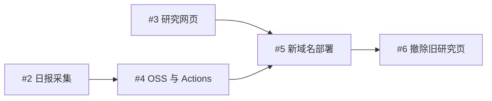

# 实现任务图

规格入口为 [#1](https://github.com/XLCYun/cangyun-papers-tracker/issues/1)，实现集成分支为 `codex/research-site-integration`。

| 任务 | 验收边界 |
| --- | --- |
| [#2](https://github.com/XLCYun/cangyun-papers-tracker/issues/2) | 采集命令输出完整 JSON；来源错误不伪装成零篇，译文失败回退英文。 |
| [#3](https://github.com/XLCYun/cangyun-papers-tracker/issues/3) | 三个网页入口及 JSON 读取、日期和搜索；完整保留 Benchmark 展示与公开范围。 |
| [#4](https://github.com/XLCYun/cangyun-papers-tracker/issues/4) | JSON Git 备份、OSS 对象和索引发布；真实 Actions 首次执行通过。 |
| [#5](https://github.com/XLCYun/cangyun-papers-tracker/issues/5) | DNS、HTTPS、路由、CORS、静态版本切换和浏览器实际显示。 |
| [#6](https://github.com/XLCYun/cangyun-papers-tracker/issues/6) | 新站验证后撤除旧站研究页，官网其他公开行为正常。 |

各实现任务使用独立分支与工作区，合入集成分支前先同步其最新提交。最终分别审核规格符合性和代码规范；验收完成后在 GitHub Issues 关闭任务。

2026-10-22 已完成全部实现及线上验收：研究站三个入口、Git 与 OSS 日报、两个来源的 CORS、HTTPS 与证书续期，以及旧站研究路径 404。Python 67 项、网页 26 项、原站 17 项测试通过；规范与需求两轴审查的发现均已修复并复核。每日数据独立于静态页面发布，后续更新不需要重建页面。
